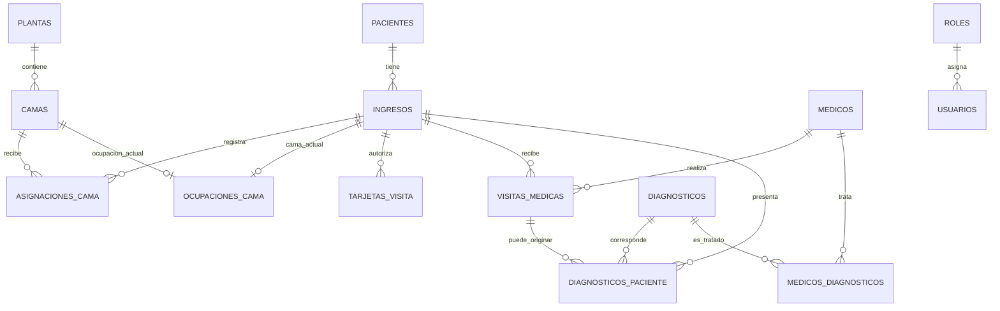

# Modelo relacional - Hospital General

## Entidades principales

- **PACIENTES**: `id_paciente` PK; NSS y DNI cifrados (`nss_cifrado`, `dni_cifrado`) con índices HMAC únicos; nombre, apellidos y fecha de nacimiento.
- **PLANTAS**: `numero_planta` PK; nombre y capacidad.
- **CAMAS**: PK compuesta (`numero_planta`, `numero_cama`); FK a PLANTAS.
- **INGRESOS**: `id_ingreso` PK; FK a PACIENTES; fecha de ingreso. Solo contiene ingresos abiertos y `id_paciente` es único para impedir dos ingresos simultáneos.
- **ASIGNACIONES_CAMA**: `id_asignacion` PK; FK a INGRESOS y FK compuesta a CAMAS; fecha de inicio y fecha de fin nullable.
- **OCUPACIONES_CAMA**: PK compuesta (`numero_planta`, `numero_cama`), `id_ingreso` único e `id_asignacion` único; representa solamente la ocupación vigente y apunta a una asignación exacta.
- **TARJETAS_VISITA**: `id_tarjeta` PK; FK a INGRESOS; número de tarjeta, horario y estado. `slot_activo` es una columna generada que toma el número de la tarjeta si está activa y NULL si no lo está; su índice único junto con `CHECK` 1..4 limita a cuatro tarjetas activas por ingreso.
- **MEDICOS**: `codigo_medico` PK; nombre, apellidos y especialidad.
- **DIAGNOSTICOS**: `codigo_diagnostico` PK; descripción cifrada.
- **MEDICOS_DIAGNOSTICOS**: PK compuesta (`codigo_medico`, `codigo_diagnostico`); resuelve la relación N:M.
- **VISITAS_MEDICAS**: `id_visita` PK; FK a INGRESOS y MEDICOS; fecha/hora.
- **DIAGNOSTICOS_PACIENTE**: `id_registro` PK; FK a INGRESOS y DIAGNOSTICOS; fecha y FK compuesta opcional a VISITAS_MEDICAS (`id_visita`, `id_ingreso`).
- **HISTORICO_***: tablas de archivo con la estancia, las asignaciones, tarjetas, visitas y diagnósticos copiados al dar de alta.
- **USUARIOS / ROLES**: autenticación y autorización básica.

## Cardinalidades

## Decisiones de integridad

1. La cama se identifica por planta y número: el número de cama no es global.
2. ASIGNACIONES_CAMA guarda los movimientos históricos; OCUPACIONES_CAMA mantiene únicamente la ocupación actual. Sus restricciones únicas impiden dos ocupaciones simultáneas.
3. Los ingresos se mantienen en la tabla operativa mientras están abiertos. Al dar de alta, el procedimiento `sp_archivar_ingreso` copia los registros relacionados y los elimina de las tablas operativas dentro de una transacción.
4. La relación entre diagnóstico y visita utiliza la combinación de identificador de visita e ingreso para impedir asociar una visita perteneciente a otra estancia.
5. Las claves foráneas usan `ON DELETE RESTRICT` para evitar eliminaciones accidentales con pérdida de trazabilidad.
